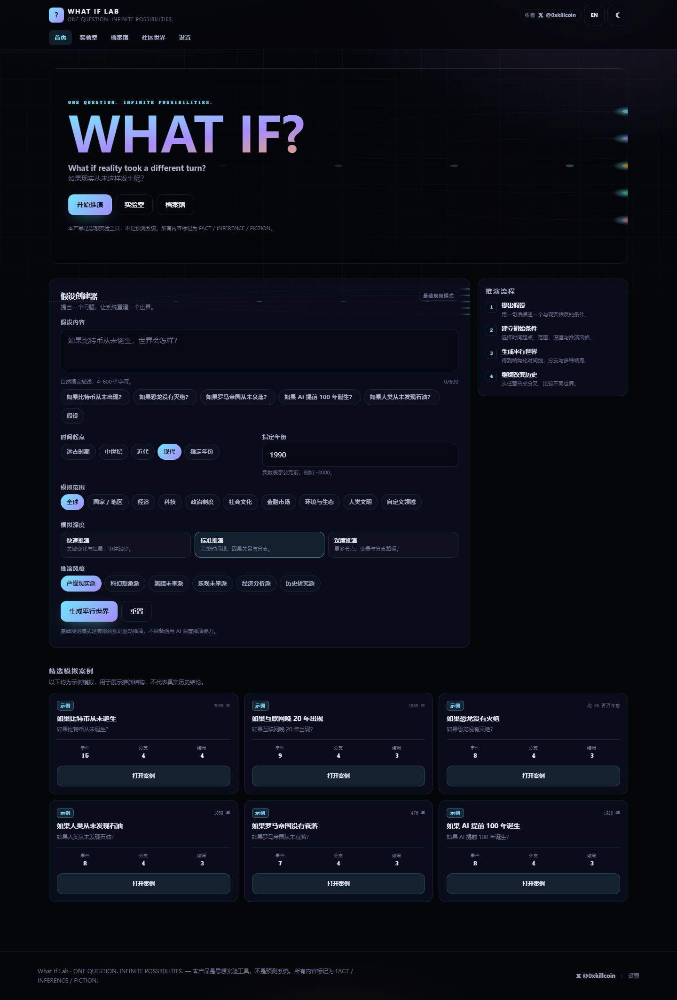
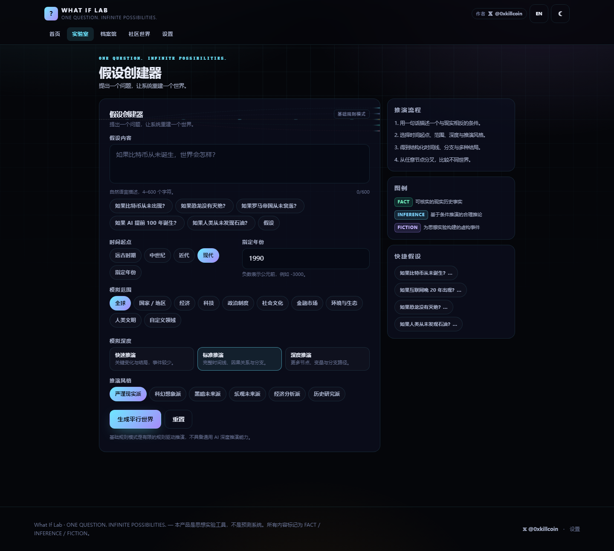
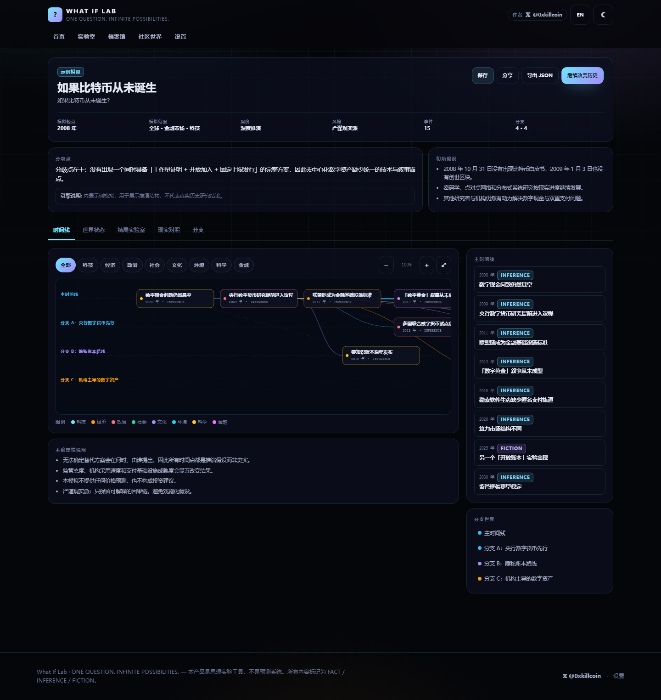
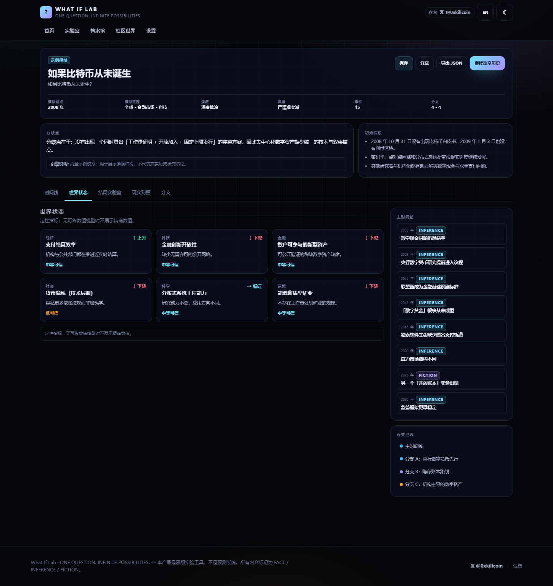
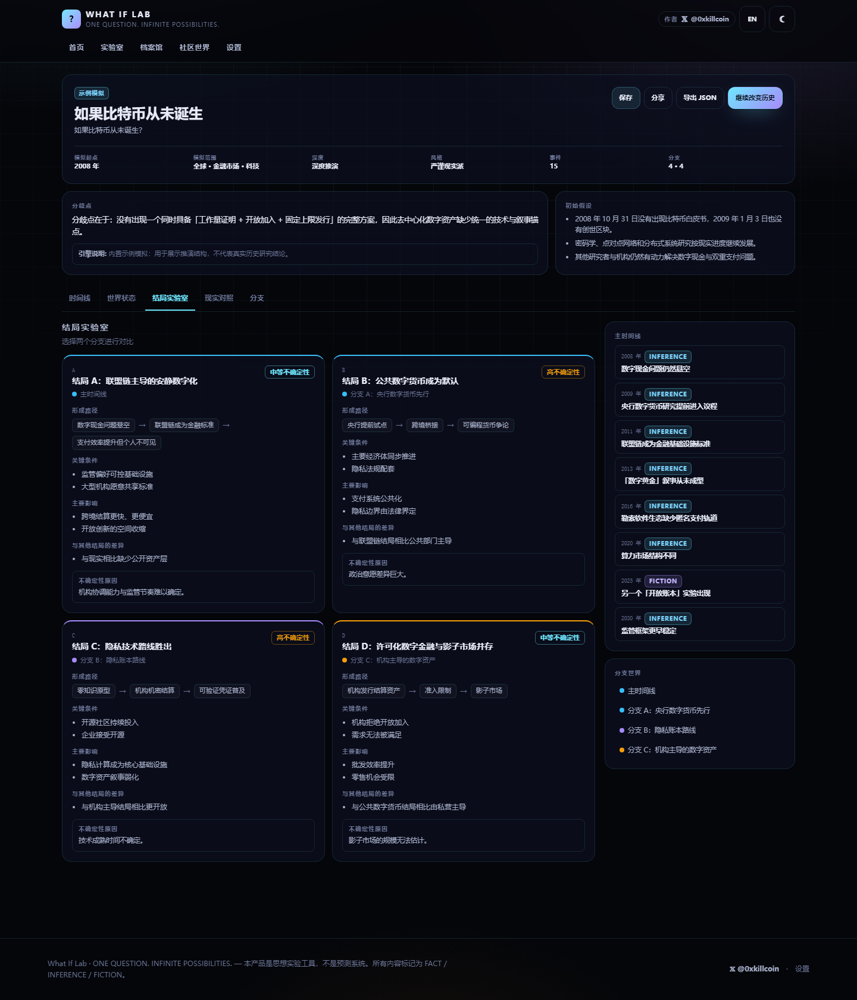
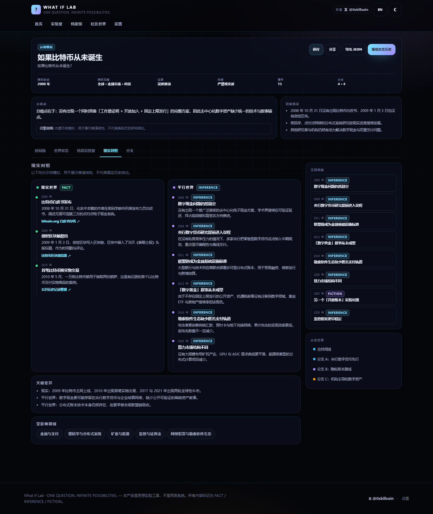
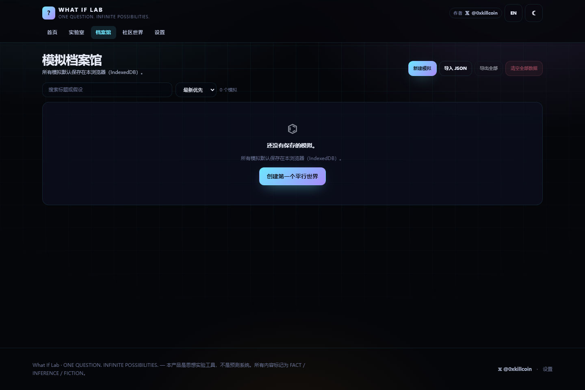
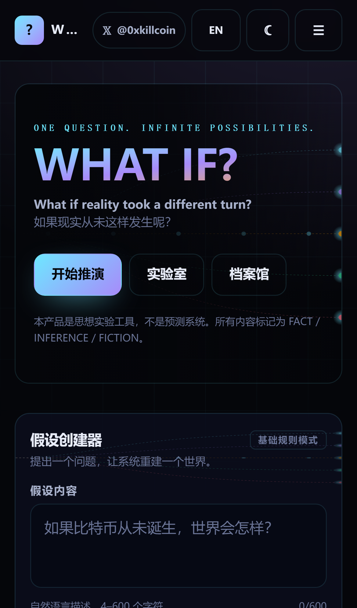
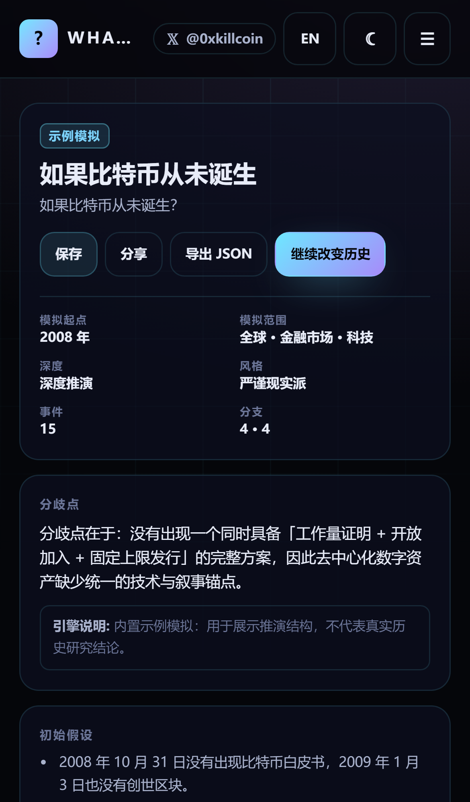

<div align="center">

# What If Lab · 平行世界模拟实验室

**ONE QUESTION. INFINITE POSSIBILITIES.**

如果现实没有这样发生，世界会变成什么样？

[](https://github.com/iiiiiiiiiiiiiKK/what-if-lab/actions/workflows/ci.yml)
[](https://github.com/iiiiiiiiiiiiiKK/what-if-lab/actions/workflows/deploy-pages.yml)
[](./LICENSE)
[](https://react.dev)
[](https://www.typescriptlang.org)

[在线体验 Live Demo](https://iiiiiiiiiiiiiKK.github.io/what-if-lab/) · [English](#english) · [作者 𝕏 @0xkillcoin](https://x.com/0xkillcoin)

</div>

---

## 目录

- [这是什么](#这是什么)
- [它解决什么问题](#它解决什么问题)
- [在线演示](#在线演示)
- [功能截图](#功能截图)
- [核心功能](#核心功能)
- [推演引擎设计](#推演引擎设计)
- [AI 模式配置](#ai-模式配置)
- [技术架构](#技术架构)
- [本地运行](#本地运行)
- [测试](#测试)
- [部署](#部署)
- [数据与隐私](#数据与隐私)
- [模拟结果限制](#模拟结果限制)
- [已知限制与路线图](#已知限制与路线图)
- [贡献](#贡献)
- [许可证](#许可证)

---

## 这是什么

**What If Lab** 是一个平行世界假设模拟平台。你提出一个与现实相反的条件，系统把它拆解成**结构化的模拟数据**——初始假设、现实基线、分歧点、时间线事件、分支世界、多种结局、世界状态指标、不确定性说明——而不是只生成一段文字。

首页不是聊天框，而是一张不断延伸的**平行宇宙分支图**：中间是现实时间线，四周是不同假设世界。

> ⚠️ 这是一个**思想实验与情景推演工具**，不是预测未来的科学系统。所有内容都强制标注 `FACT` / `INFERENCE` / `FICTION`，系统不会把推论包装成史实，也不会凭空生成精确概率。

## 它解决什么问题

普通 AI 聊天只能给出一段看上去合理的文字，无法保留结构，也无法比较。What If Lab 要解决的是：

1. **结构可复用** — 推演结果是带 Schema 的数据（时间线、因果链、分支、结局），可以渲染成图、可以比较、可以导出。
2. **事实与虚构可分辨** — 每个事件都带内容性质与可信程度标记，`FACT` 只允许出现在经过核实的现实基线上，并附带真实来源链接。
3. **可以继续分叉** — 从任意事件节点创建分支，主时间线永不被覆盖，从而比较不同世界。
4. **默认离线可用** — 不配置任何 API 也能用（内置规则引擎 + 9 个高质量示例）；模拟数据默认只存本地 IndexedDB。

## 在线演示

- **GitHub Pages**：<https://iiiiiiiiiiiiiKK.github.io/what-if-lab/>
- 纯前端静态托管，无需登录，无需后端。

> 仓库名：`what-if-lab`（产品全名 What If Lab / 平行世界模拟实验室）

## 功能截图

所有截图都由 `scripts/screenshots.mjs` 从**真实运行的构建产物**中抓取，不是设计稿。

| 首页 · 宇宙分支地图 | 假设创建器 |
| --- | --- |
|  |  |

| 时间线探索器（桌面） | 世界状态面板 |
| --- | --- |
|  |  |

| 结局实验室 | 现实世界对照 |
| --- | --- |
|  |  |

| 模拟档案馆 | 移动端首页（iPhone 视口） |
| --- | --- |
|  |  |

| 移动端纵向时间线 |
| --- |
|  |

## 核心功能

### 1. 首页 · 平行宇宙入口
- 巨型 `WHAT IF?` 主视觉 + SVG 分支宇宙图（现实主线 + 各假设世界）。
- 6 个快捷假设 chips，9 个可直接打开的示例模拟（全部标记为示例，不冒充历史结论）。
- 顶部固定栏包含**作者 𝕏 链接**（`https://x.com/0xkillcoin`）、中英切换、深浅色切换。

### 2. Hypothesis Builder · 假设创建器

| 设置项 | 取值 |
| --- | --- |
| 假设内容 | 自然语言，4–600 字符，实时字数提示，校验失败给出具体原因 |
| 时间起点 | 远古 / 中世纪 / 近代 / 现代 / 指定年份（支持负数=公元前） |
| 模拟范围 | 全球、国家地区、经济、科技、政治制度、社会文化、金融市场、环境生态、人类文明、自定义（多选） |
| 模拟深度 | 快速（3 事件）/ 标准 / 深度（更多节点与分支） |
| 推演风格 | 严谨现实 / 科幻想象 / 黑暗未来 / 乐观未来 / 经济分析 / 历史研究 |

### 3. Timeline Explorer · 时间线
- **桌面端**：横向 SVG 时间线，D3 缩放/拖动，按分支分泳道，因果曲线连接 `parentEventId`。
- **移动端**：**不是把桌面画布缩小**，而是切换为纵向时间线 + 分支分组，点击节点弹出详情。
- 支持领域筛选、缩放按钮、适应视图、事件详情（发生了什么 / 为什么 / 直接后果 / 长期影响 / 影响对象 / 相关事件 / 可信程度 / 内容性质）。

### 4. Branching Worlds · 分支世界
- 从任意事件节点「从此事件创建分支」，输入分支名称与变化条件。
- **主时间线与已有分支字节级不变**（单元测试断言新模拟的前 N 个事件与父模拟完全相等），分叉只追加数据。
- 分支列表支持激活（聚焦该分支泳道）、两两对比、循环引用与悬空父事件检测。

### 5. World State · 世界状态面板
- 按领域给出定性指标：`上升 / 下降 / 稳定 / 未知` + 可信程度 + 说明。
- **没有可靠数值模型时不展示精确数值**。若未来接入量化模型，`quantified` 字段强制要求来源、方法、假设、适用范围。

### 6. Outcome Lab · 结局实验室
- 每个结局包含：形成路径、关键条件、主要影响、不确定性等级与**原因**、与其他结局的差异。
- 使用 `低/中/高不确定性`，**绝不显示「78% 概率」这类无依据数字**。

### 7. Reality Comparison · 现实对照
- 左列现实世界（FACT，带真实来源链接），右列平行世界（INFERENCE/FICTION）。
- 关键差异与被改变领域并排展示；无法核实的历史会显式标记为「待核实背景信息」。

### 8. What If Again · 继续改变历史
- 从任意模拟派生新版本，记录 `parentId` 与 `versionNote`，**不覆盖**原模拟。

### 9. Simulation Library · 档案馆
- IndexedDB（Dexie）本地保存，卡片展示标题、假设、事件/分支/结局数量、深度、引擎类型。
- 搜索、排序（最新/最早/标题）、重命名、复制、删除、单条/全部导出 JSON、导入 JSON（Zod 校验、导入时重新分配 id 以免覆盖本地世界）。
- IndexedDB 不可用时自动降级到内存并给出提示。

### 10. Community Worlds · 社区
- 无云端后端，因此**只展示内置案例与本机作品**；页面明确解释原因，绝不伪造用户数、点赞或浏览量。

### 11. 全局
- 中/英双语（全部文案来自字典，无硬编码）、深/浅色主题、`prefers-reduced-motion` 支持、错误边界防止白屏、移动端安全区适配。

## 推演引擎设计

### Mode A · 基础规则模式（无需任何配置）

```
hypothesis ──► matchArchetype()  ──► 9 个内置推演模板之一
                     │
                     └─ 未命中 ──► createGenericArchetype()  中性结构骨架
                                        │
        ┌───────────────────────────────┘
        ▼
  展开为 Simulation 数据（按 depth 裁剪事件/分支/结局/指标数量）
        │
        ▼
  Zod simulationSchema 校验 ──► 写入 IndexedDB ──► 路由到 /world/:id
```

- 内置模板：比特币、互联网晚 20 年、恐龙灭绝、石油、罗马帝国、AI 提前 100 年、美元霸权、1900 年太空旅行、无月球。
- 每个模板包含：初始假设、分歧点、现实基线（带真实 URL）、主线事件（含因果 `parentIndex`）、3 个分支、多个结局、定性指标、不确定性说明、中英双语文本。
- **未命中模板时**生成中性骨架：明确写出「这是规则驱动的结构性推演骨架，不是领域专家的实证分析」，且 `baselineFacts` 为空——**宁可不写，也不编造历史**。

### Mode B · AI 推演（可选）

分 **5 个阶段**请求，避免一次性超长输出卡死页面，每阶段独立校验：

| 阶段 | 产出 | 失败处理 |
| --- | --- | --- |
| `outline` | 标题、假设、分歧点、现实基线、不确定性 | Schema 校验 → 一次结构化修复重试 |
| `timeline` | 8–14 个事件 + 因果 `parentRef` | 同上 |
| `branches` | 3 个分支（首条必须为主时间线） | 同上 |
| `outcomes` | 3–4 个结局 | 同上 |
| `state` | 世界状态指标 + 现实对照差异 | 同上 |

另外实现：

- **JSON 容错解析**：裸 JSON、带 `json` 代码块、被散文包裹的对象都能提取。
- **错误分类**：`network / timeout / auth / rate / schema / cancelled / empty / noConfig`，分别给出中英文提示。
- **可取消**：`AbortController` + `AbortSignal.timeout`，取消后不写入档案馆，也**不会伪造「生成完成」**。
- **进度可见**：阶段名 + 百分比进度条。
- **密钥安全**：默认走**服务端代理**（`server/ai-proxy.mjs`，密钥只在服务端）；浏览器直连模式必须在 UI 上看到明确风险提示，且只存本地 localStorage。
- AI 产出同样要过 `simulationSchema`，不合法内容永不进入档案馆。

## AI 模式配置

### 推荐：服务端代理

```bash
# .env（不要提交）
AI_BASE_URL=https://api.openai.com/v1
AI_API_KEY=sk-...
AI_MODEL=gpt-4o-mini

node server/ai-proxy.mjs          # http://localhost:8787/api/simulate
```

然后在应用内 **设置 → AI 推演模式 → 服务端代理**，填入该地址即可。代理只转发 `model / messages / temperature`，带速率限制、请求体上限与超时，且**不记录提示词与密钥**。

### 备选：浏览器直连

**设置 → AI 推演模式 → 浏览器直连**，填写 Base URL、API Key、模型名。密钥仅存本地 `localStorage`，请求直接发往第三方——界面会显示风险警告。**生产环境请使用代理。**

### 环境变量

| 变量 | 用途 | 是否必须 |
| --- | --- | --- |
| `AI_BASE_URL` | OpenAI 兼容端点 | 仅 AI 代理 |
| `AI_API_KEY` | 服务端密钥（绝不可加 `VITE_` 前缀） | 仅 AI 代理 |
| `AI_MODEL` | 默认模型名 | 仅 AI 代理 |
| `PORT` | 代理端口，默认 8787 | 否 |
| `ALLOWED_ORIGIN` | CORS 白名单，生产建议收紧 | 否 |
| `GITHUB_PAGES_BASE` | 构建时 base path，CI 自动设为 `/<repo>/` | 否 |

完整模板见 [`.env.example`](./.env.example)。

## 技术架构

```
src/
├── app/                     # 路由与页面（Home/Lab/World/Library/Community/Settings/404）
│   ├── App.tsx
│   └── pages/
├── components/              # 通用 UI（Badges、AppShell、ErrorBoundary、ThemeSync）
│   └── visual/UniverseHero  # 首页宇宙分支 SVG
├── features/                # 业务功能模块
│   ├── hypothesis/          # 假设创建器
│   ├── timeline/            # 时间线 + 布局算法 + 事件详情
│   ├── branches/            # 分支面板 + 世界对比
│   ├── world-state/         # 世界状态
│   ├── outcomes/            # 结局实验室
│   └── reality-comparison/  # 现实对照
├── engines/
│   ├── ruleEngine.ts        # 规则引擎（模板 → Simulation）
│   ├── generic.ts           # 未命中模板时的中性骨架
│   ├── aiEngine.ts          # 五阶段 AI 生成 + 校验 + 修复
│   └── branchEngine.ts      # 分叉、版本、完整性校验（循环检测）
├── data/archetypes/         # 9 个内置推演模板（中英双语）
├── db/database.ts           # Dexie / IndexedDB + 内存降级
├── stores/                  # Zustand（偏好持久化 / 当前模拟）
├── types/simulation.ts      # 全部 Zod Schema（单一数据真相）
├── locales/dictionary.ts    # 中英字典
└── utils/                   # id、可复现 PRNG
```

| 层 | 选择 | 理由 |
| --- | --- | --- |
| 框架 | React 19 + TypeScript 7 | 类型即契约，`simulationSchema` 贯穿引擎/存储/导入 |
| 构建 | Vite 8 | 秒级构建，`base` 可配置以适配 GitHub Pages |
| 样式 | Tailwind CSS 4 + CSS 变量 | 深浅色靠 CSS 变量切换，无需双份样式；移动端优先 |
| 状态 | Zustand（持久化偏好）+ Dexie（数据） | 偏好走 localStorage，模拟走 IndexedDB，职责分离 |
| 可视化 | d3-scale / d3-selection / d3-zoom + 手写 SVG 布局 | 只引需要的模块（bundle 从 769 KB 减小），布局算法可单测 |
| 校验 | Zod 4 | 输入、AI 输出、导入文件、导出包全部校验 |
| 测试 | Vitest + Testing Library + Playwright | 单测覆盖引擎/DB/布局，E2E 覆盖真实浏览器流程与 iPhone 视口 |

**为什么不用 Three.js**：时间线、分支与因果关系的可读性比炫技重要；纯 SVG 在移动端更省电，也更容易做无障碍与键盘操作。

## 本地运行

```bash
git clone https://github.com/iiiiiiiiiiiiiKK/what-if-lab.git
cd what-if-lab
npm install
npm run dev            # http://localhost:5173
```

其他命令：

```bash
npm run typecheck      # tsc -b
npm run lint           # oxlint
npm test               # vitest run（45 个用例）
npm run test:coverage  # 覆盖率
npm run build          # 生产构建 → dist/
npm run preview        # 预览构建产物 http://127.0.0.1:4173
npx playwright test    # E2E（22 个用例 × Desktop/iPhone，使用本机 Chrome）
```

## 测试

| 层级 | 工具 | 结果 |
| --- | --- | --- |
| 类型检查 | `tsc -b` | 0 error |
| Lint | oxlint（116 rules / 56 files） | 0 error, 0 warning |
| 单元 / 组件测试 | Vitest + Testing Library | **45 passed / 45**（8 个文件） |
| 端到端 | Playwright（Desktop Chrome + iPhone 13 视口 两个 project） | **22 passed / 22** |
| 生产构建 | `vite build` | 成功 |

覆盖的关键路径：

- 引擎：模板命中/未命中、内容性质标记规则、确定性、深度单调性、中英输出。
- 分支：主时间线不被覆盖、完整性校验（悬空父事件、自引用、**循环检测**）。
- AI：JSON 容错提取（裸 JSON / 代码块 / 散文包裹）、Schema 拒绝非法 `nature`、缺失字段。
- 数据：IndexedDB 增删改查、排序、清空、降级路径。
- 布局：同泳道去重叠、跨泳道分道、年份范围、年代格式化（含公元前与百万年尺度）。
- E2E：创建模拟 → 世界页；示例切换全部 Tab；刷新后档案馆仍存在；从事件分叉；中英/深浅色切换；空输入校验；**移动端无横向溢出**、**纵向时间线**、**移动端导航抽屉**、**作者 𝕏 链接可见**。

## 部署

### GitHub Pages（当前线上方案，纯静态）

仓库已包含 [`.github/workflows/deploy-pages.yml`](./.github/workflows/deploy-pages.yml)：push 到 `main` 后自动 `npm ci → build（base=/what-if-lab/）→ upload-pages-artifact → deploy-pages`。

首次启用需在仓库 **Settings → Pages → Build and deployment → Source** 选择 **GitHub Actions**。

### Cloudflare Pages

```
Build command:  npm run build
Output dir:     dist
Env (optional): GITHUB_PAGES_BASE=/
```

### Vercel

```
Framework preset: Vite
Build command:    npm run build
Output dir:       dist
```

需要 AI 代理时，把 `server/ai-proxy.mjs` 的逻辑迁到 `api/simulate.ts` 即可（同样的请求体契约）。

> 采用 **HashRouter**，因此任何静态托管下深链接都直接可用，无需服务端重写规则。

## 数据与隐私

- **Local-first**：模拟、时间线、分支、结局、设置默认只写入本浏览器 IndexedDB。
- 可导出/导入 JSON；可删除单条或清空全部。
- **不配置 AI 时，输入内容不会离开浏览器**。
- 启用 AI 时，只有假设文本、起点、深度、范围等字段会发送到你配置的服务；UI 上会明确提示。
- 仓库中**没有任何真实密钥**；API Key 只存在于你的浏览器 localStorage 或你自己的服务端环境变量。
- 应用不会采集分析数据、不加载第三方追踪脚本、不伪造社区数据。

## 模拟结果限制

- 不是预测系统，不提供概率。任何 `INFERENCE` / `FICTION` 都不是历史结论。
- 现实基线仅收录能给出可核实来源的事件；给不出来就留空，绝不编造引用。
- 无可靠数值模型时只给定性方向（上升/下降/稳定/未知），不生成 GDP、人口、价格等精确数字。
- 内置模板是**示例级精心设计**，不等于严肃史学或经济学研究。
- 世界状态指标可能互相矛盾，这在思想实验中是正常现象，应视为讨论起点而非结论。

## 已知限制与路线图

已明确记录的限制：

1. 规则引擎只在命中 9 个模板时有深度内容；其他假设只能得到中性骨架（这是诚实的功能边界）。
2. AI 模式的输出质量取决于所配置模型；分阶段生成增加了请求次数（5 次/模拟）。
3. 社区模块无云端后端——没有账号、存储、举报机制，因此**不提供真正的公开发布**。
4. 时间线在事件极多（>200）时 SVG 节点会变密，缩放与平移仍可用，但需要后续虚拟化/Canvas 方案。
5. 现实基线的来源链接为人工整理，未做自动化活链检测。

下一步最值得做的三件事：

1. **领域模板扩充 + 可插拔**：把 archetype 变成可贡献的数据包，配套 Schema 测试。
2. **可分享的只读世界链接**：用 URL 压缩 + 哈希承载，无需后端即可分享单个世界。
3. **真正的社区后端**：账号 + 数据库 + 访问控制 + 举报，先把隐私与内容审核设计写清楚再上线。

## 贡献

欢迎提交 Issue 与 PR：

```bash
npm install
npm run typecheck && npm run lint && npm test
npx playwright test
```

- 新增推演模板请放在 `src/data/archetypes/`，并保证中英双语、来源可核实、`nature` 标记正确。
- 不要在代码、Issue 或日志中粘贴真实 API Key。
- 提交前请确认 `npm run build` 通过。

## 许可证

[MIT](./LICENSE) © 2026 What If Lab contributors

依赖许可已核验：React/MIT、Zustand/MIT、Zod/MIT、React Router/MIT、D3 子模块/ISC、clsx/MIT、Tailwind CSS/MIT、Dexie/Apache-2.0（与 MIT 兼容）。

---

<div align="center">

**作者** · [𝕏 @0xkillcoin](https://x.com/0xkillcoin)

</div>

---

# English

## What is this?

**What If Lab** is a parallel-world simulator. You ask one counterfactual question; the app builds a **structured simulation** — initial assumptions, real-world baseline, divergence point, timeline events with causal links, branching worlds, several outcomes, world-state indicators and explicit uncertainty notes — instead of a wall of prose.

The home page is not a chat box: it is a branching universe map, with the real timeline in the middle and hypothetical worlds radiating outward.

> ⚠️ This is a **thought-experiment tool**, not a prediction system. Every item is labelled `FACT` / `INFERENCE` / `FICTION`. Inferences are never dressed up as history, and no unsupported probabilities are ever shown.

## Highlights

- **Structured, not conversational** — output is typed data validated by Zod, so it renders as a timeline, is comparable, and exports cleanly.
- **Honest labelling** — `FACT` is reserved for verifiable real events with a real source URL; unverifiable background is explicitly marked as needing verification.
- **Non-destructive branching** — fork any event into a new branch; the main timeline is provably untouched (asserted in unit tests).
- **Works with zero configuration** — a rule engine with 9 curated archetypes plus an explicitly-labelled neutral skeleton for unmatched hypotheses.
- **Local-first** — IndexedDB by default; nothing leaves the browser unless you configure AI mode.
- **5-stage AI mode** (optional) — small, validated requests instead of one huge response; cancellable; schema-repair retry; typed error handling; server-proxy option so keys never reach the browser.

## Quick start

```bash
git clone https://github.com/iiiiiiiiiiiiiKK/what-if-lab.git
cd what-if-lab && npm install
npm run dev
```

```bash
npm run typecheck && npm run lint && npm test   # 45 tests
npx playwright test                             # 22 E2E tests (uses local Chrome)
npm run build && npm run preview
```

## Live demo

<https://iiiiiiiiiiiiiKK.github.io/what-if-lab/>

## Tech stack

React 19 · TypeScript 7 · Vite 8 · Tailwind CSS 4 · Zustand · Dexie/IndexedDB · Zod 4 · d3-scale / d3-selection / d3-zoom · Vitest · Playwright

## Privacy

Simulations live in your browser. No analytics, no trackers, no fabricated community metrics. AI mode sends only your hypothesis fields to the service *you* configure, and the UI says so before you enable it.

## Limits

Rules cover 9 curated domains; anything else gets an explicitly-labelled neutral skeleton. AI quality depends on your model. The community page has no backend, so it never pretends to have one. See the Chinese section above for the full list and roadmap.

## License

[MIT](./LICENSE) © 2026 What If Lab contributors
